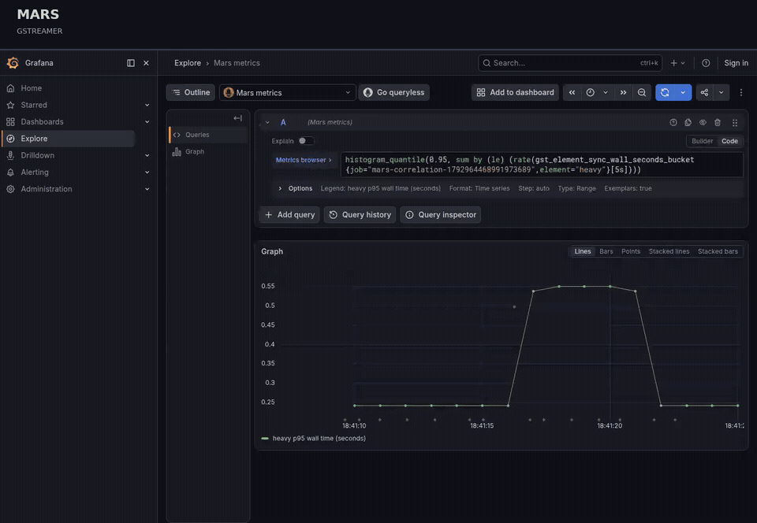

# Mars GStreamer Tracers

Find where your GStreamer pipeline spends time and CPU. Mars adds metrics,
traces, and CPU profiles through `GST_TRACERS`, without changing your pipeline
code.

Follow a slow measurement to its trace, then inspect the CPU calls for that
element span:

[](docs/media/correlation.mp4)

[Watch the video](docs/media/correlation.mp4) ·
[Try the demo](tracer/otel/CORRELATION.md#try-the-local-demo)

## Choose a tracer

| I want to… | Use | Send data to | Approx. CPU overhead |
| --- | --- | --- | --- |
| Measure element latency, blocking, and queue pressure | [mars-metrics](tracer/prometheus/README.md) | Prometheus | <1% expected on video workloads |
| Collect CPU call stack profiles | [mars-profiles](tracer/otel/PROFILES.md) | Pyroscope | ~1% |
| Investigate with correlated metrics, traces, logs, and profiles | [mars-instrument](tracer/otel/INSTRUMENT.md) | Prometheus / OTLP collector + Pyroscope | ~1% for metrics + traces; ~3% with profiles + logs |

Start with **mars-metrics** if you are unsure, as it carries the least overhead of these options.

Use **mars-profiles** to find CPU hotspots, or **mars-instrument** to connect a
measurement to a trace and its CPU samples. `mars-otel` remains available as a
compatibility entry point for existing trace configurations.

With `mars-instrument`, select just what you need:

```sh
GST_TRACERS='mars-instrument(signals="metrics,traces,profiles")'
```

Metrics can go to Prometheus or an OTLP collector. The
[instrumentation guide](tracer/otel/INSTRUMENT.md) has complete launch commands.
Instrumentation health defaults to `core`; use `monitoring=none` or
`monitoring=all` to change the detail. See the
[health metrics and dashboard](tracer/otel/INSTRUMENT.md#monitor-the-instrumentation).

For a list of available metrics, see the [prometheus plugin README.md](https://github.com/LrWm3/gst-tracer-otel/blob/main/tracer/prometheus/README.md#metric-semantics).

See the [performance reports](reports/README.md) for measured CPU and memory costs on the tested pipelines for each tracer.

These are rounded planning figures from our x86-64
[1080p video measurements](reports/otel/INSTRUMENT_VIDEO_RESULTS.md): extra CPU
cycles with default export settings, 100% trace sampling, 100 Hz profiles, and
one log per frame when enabled. Small sub-percent results overlap baseline
variation; these are not limits or FPS-loss estimates. `mars-instrument` added
about **5 MiB peak RSS** by default and **45 MiB** with profiles/logs;
[profiles alone](reports/otel/PROFILE_VIDEO_RESULTS.md) added **41 MiB**.
The metrics figure comes from separate [video benchmarks](reports/prometheus/BENCHMARK.md).
These measurements cover the existing defaults; the new explicit full-metrics
configurations have not yet been benchmarked.
These x86-64 figures predate element-attributed profiles; see the
[attribution review](reports/otel/PROFILE_ELEMENT_REVIEW.md) for its additional
cost and screenshots.

On an integrated memory nvidia device, a separate [1080p check](reports/otel/ARM64_PROFILES.md#video-cpu-and-memory-check)
with element attribution measured about **1.3% extra process CPU time** for
profiles and **3.1%** for OTel with profiles and logs. In subsequent
[lifecycle tests](reports/otel/ARM64_PROFILES.md#deadlock-and-memory-growth-check),
memory settled and no hangs were observed, but process RSS peaked at
**125–140 MiB** in these builds with debug information. Allow for these temporary
memory peaks; the measurements are workload-specific, not production guarantees.

## Get your first metrics

You need Rust/Cargo, a C compiler, `pkg-config`, GStreamer and GLib development
headers, GStreamer command-line tools and base plugins, and `curl`. See
[environment setup](CONTRIBUTING.md#environment) for the provided development
container and setup helpers. `just` is optional.

From the repository root, build the metrics plugin and run a live test pipeline:

```sh
cargo build --release -p gst-prometheus-tracer

GST_PLUGIN_PATH="$PWD/target/release" \
GST_TRACERS='mars-metrics(port=9092)' \
  gst-launch-1.0 videotestsrc is-live=true ! videoconvert ! fakesink
```

Leave the pipeline running. In a **second terminal**, fetch its metrics:

```sh
curl http://localhost:9092/metrics
```

Look for `gst_element_latency_count_count` and
`gst_element_sync_wall_seconds_bucket`, with labels identifying pipeline elements.
No Prometheus server is needed to try this; to retain measurements, configure
Prometheus to scrape this endpoint. The metrics server listens on all interfaces
on the chosen port.

To instrument your application, set the same `GST_PLUGIN_PATH` and `GST_TRACERS`
when launching it. Replace the example pipeline with your own, or see the
[metrics guide](tracer/prometheus/README.md) for element filters, sampling,
queue metrics, and PromQL examples.

If the tracer does not load, check that GStreamer can find it:

```sh
GST_PLUGIN_PATH="$PWD/target/release" gst-inspect-1.0 mars-metrics
```

## Add traces or profiles

Each guide includes its build command, backend requirements, and configuration:

- [Combined instrumentation](tracer/otel/INSTRUMENT.md): metrics and traces
  together, with optional correlated logs and CPU profiles.
- [Trace collection](tracer/otel/README.md): push-call spans, trace sampling,
  traces-only operation, and compatibility with `mars-otel`.
- [CPU profiles](tracer/otel/PROFILES.md): native stacks grouped by element
  instance or task owner, including frame pointers and debug symbols.

Choose one of `mars-instrument`, `mars-otel`, or `mars-profiles` per process;
they share one configuration. Profiling requires Linux x86-64 or arm64, the
`profiles` build feature, and GStreamer 1.22 or newer.

For clickable trace-to-profile links, follow the
[Grafana correlation setup](tracer/otel/CORRELATION.md). It includes the data-source
configuration and a local demo that checks real traces and profiles through Grafana.
The demo also stores metric exemplars: follow a slow measurement to its trace,
then open the span's CPU profile to see which element and native functions ran.

## Know what you are measuring

- **Metrics assume synchronous calls.** Metrics may still hint at non-sync latency
  depending on if the elements underlying queues are saturated.
- **Metrics do not support bin elements.** Latency is measured across bin sub-elements.
  If you see elements you do not recognize from your pipeline, it is possible it is from
  a bin element.
- **No async support.** `mars-metrics` supports push, pull, and buffer
  lists, as does explicit `signals="metrics"` collection in `mars-instrument`.
  Trace spans and metric exemplars cover ordinary pushes and pull reads. Regular
  `queue` and `multiqueue` thread boundaries are supported, but `threadshare`
  asynchronous boundaries are not handled correctly by the element timings.
  If this is important to you, please open an issue and it can be explored.
- **CPU profiling supports Linux x86-64 and arm64 (AArch64).** It samples participating
  streaming threads, with [stack and shutdown limitations](tracer/otel/PROFILES.md#sampling-and-shutdown).
  On an integrated memory nvidia device, check that the application environment has GStreamer
  1.22 or newer; see the [ARM build notes](tracer/otel/PROFILES.md#linux-arm64).

## Further reading

- [Performance reports](reports/README.md): measured overhead and reproduction instructions.
- [Contributing](CONTRIBUTING.md): development setup, tests, benchmarks, and remaining work.

## License and credits

Distributed under the GNU Library General Public License (LGPL), version 2 or
later. See [LICENSE](LICENSE).

Inspired by GStreamer's [gstlatency.c](https://gitlab.freedesktop.org/gstreamer/gstreamer/-/blob/main/subprojects/gstreamer/plugins/tracers/gstlatency.c),
written by [Stefan Sauer](mailto:ensonic@users.sf.net), with Rust implementations
and Prometheus, OpenTelemetry, and Pyroscope integration.
