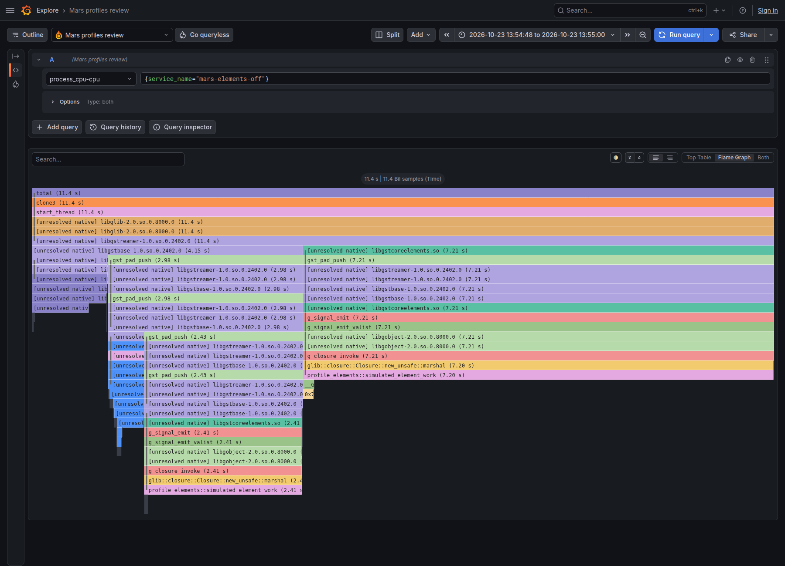
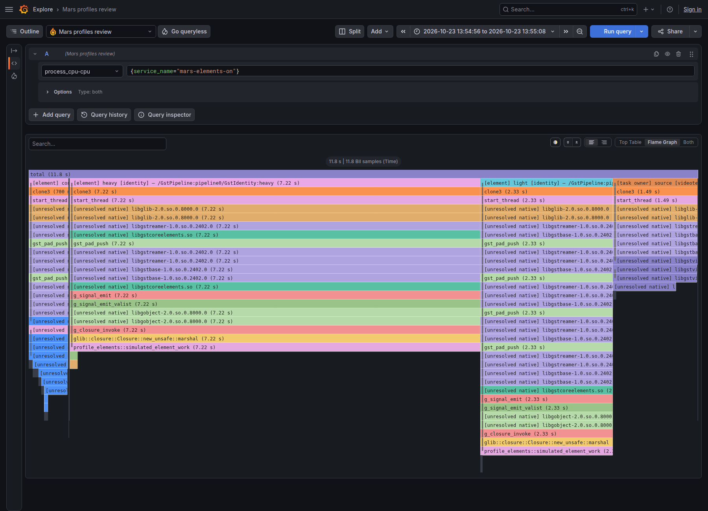
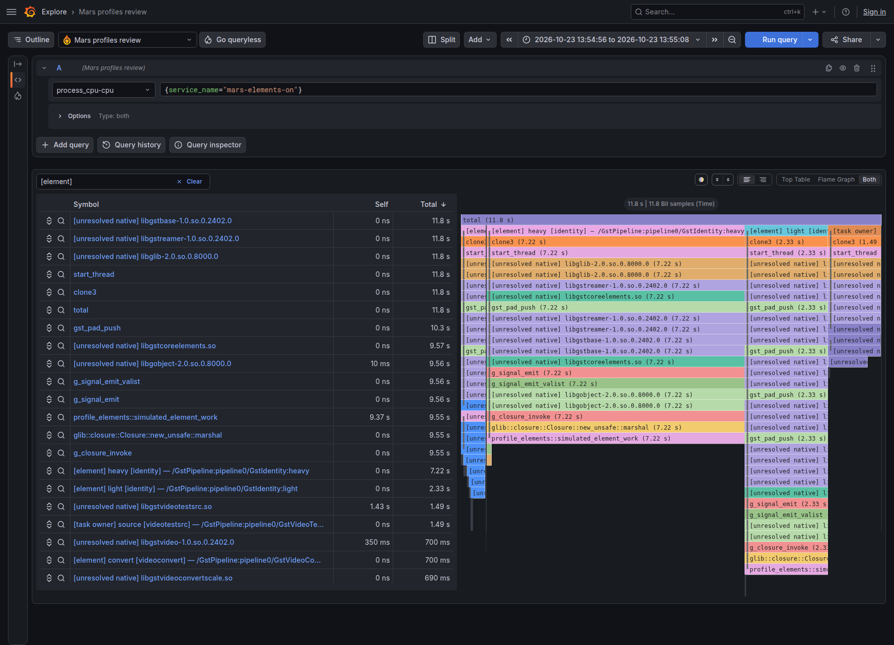

# Element-attributed CPU profiles

Review branch: `impl/profile-element-attribution`, based on `68739fb`.
Captured on 2026-10-23 using Pyroscope 2.4.0 and Grafana 13.1.1.

CPU samples now identify the executing element instance, even when its native
stack consists mostly of shared GStreamer wrappers. This works in
`mars-profiles`, `mars-otel`, and `mars-instrument`, independently of tracing.
The attribution implementation is isolated in
[profilecontext.rs](../../tracer/otel/src/profilecontext.rs).

## What it looks like

The same binary ran with `GST_OTEL_PROFILE_ELEMENTS=false` and `true`.
These are actual Grafana Explore screenshots of ingested profiles. Both views
expand the native frames, including the new library-name fallback for unresolved
symbols. The comparison isolates the element grouping; the off view is not a
screenshot of an older release.

**Attribution disabled:** native wrappers and the same callback appear in
multiple branches, without element instance names.



**Attribution enabled:** `heavy`, `light`, and `convert` become named roots.
Source work appears separately under `[task owner] source`. The original native
frames remain beneath each root.



**Top table sorted by Total:** the two identity instances have distinct CPU
totals even though both execute `profile_elements::simulated_element_work`.
Synthetic frames have zero Self time; use Total to read their contribution.



## Controlled attribution check

The [example](../../tracer/otel/examples/profile_elements.rs) generates 1200
640×360 frames and runs two `identity` instances on different threads:

```text
videotestsrc name=source pattern=snow ! RGBA,640×360 !
videoconvert name=convert ! I420 ! identity name=light !
queue name=handoff ! identity name=heavy ! fakesink sync=false
```

Both identity handoffs call the same function. It deliberately consumes 2 ms of
thread CPU in `light` and 6 ms in `heavy` for each frame. This is a controlled
attribution test, not a realistic processing or overhead benchmark.

At 100 Hz, the enabled run produced 1177 samples, representing **11.77 CPU
seconds**. The decoded upload and the server's aggregate query matched exactly:

| Scope | Sampled CPU | Samples |
| --- | ---: | ---: |
| Element `heavy` (`identity`) | 7.22 s | 722 |
| Element `light` (`identity`) | 2.33 s | 233 |
| Task owner `source` (`videotestsrc`) | 1.49 s | 149 |
| Element `convert` (`videoconvert`) | 0.70 s | 70 |
| Element `handoff` (`queue`) | 0.02 s | 2 |
| Unattributed | 0.01 s | 1 |

The heavy/light ratio was **3.10**, close to the intended 3.0. Element scopes
covered 1027 samples (87.3%); task ownership covered another 149 (12.7%). No
samples were dropped, no registration or context-capacity failures occurred,
and the final active-thread count was zero. Samples retained only `thread_id`
labels in profiles-only mode. No element series labels were introduced.

The disabled run produced 1136 samples, all under the original native `clone3`
root. These two short demo runs are not an overhead comparison. See the separate
matched video check below. Raw counts, timestamps, and the binary hash are in
[attribution-results.json](profile-elements/attribution-results.json).

## Semantics and limits

- Chain, chain-list, and pull-range hooks maintain the innermost execution scope.
  A nested call replaces the current scope and restores its caller on return.
  Samples are counted once; an element total excludes samples assigned to its
  downstream children. Pull scopes identify the upstream peer that handles
  `getrange`.
- Outside a call, synchronous task ENTER/LEAVE messages provide ownership context.
  ENTER also registers the timer before the source's first buffer. This catches
  source production that previously began sampling only after the first push.
  Task ownership is not exact execution attribution: framework work and callbacks
  outside covered calls can appear there.
- Private worker pools and work on threads that never register remain uncovered.
  Events and queries retain their surrounding scope. Element context does not
  recover missing native symbols or add DWARF/JIT unwinding.
- The signal handler reads one atomic context ID. Name lookup, GObject access,
  TLS bookkeeping, registry locking, and pprof frame construction happen outside
  signals. Existing signal-handler and shutdown regression tests still pass;
  this does not establish the cause of the previously reported production hang.
- Context depth is capped at 256, descriptions at 4096, paths at 512 characters,
  and factory names at 128. Unknown context and overflow become unattributed.
  Immutable description IDs survive queued samples and element destruction.
  Metadata caches retain no strong GStreamer object references. The sample field
  adds 2 KiB per allocated 256-sample ring; descriptor storage and per-thread
  context stacks add bounded memory separately.
- Profiling builds now require GStreamer 1.22 for the typed chain hooks. Builds
  without the `profiles` feature retain their existing requirement.

See [configuration and interpretation](../../tracer/otel/PROFILES.md) for details.

## Short matched video cost check

This separate check uses the existing 1200-frame 1080p RGBA-noise → I420 video
benchmark, without the artificial identity workload. All modes use the same
release binary with frame pointers, Rust 1.89.0, stock GStreamer 1.24.2, and
100 Hz profiling. There are three measured repetitions per mode after one
discarded warm-up, with rotating order. The child uses CPUs 0 and 2 and the
receiver CPU 4 on the same i5-1345U host as the earlier video measurements.
No builds, tests, or browser captures ran during this series.

| Mode | Median process cycles | Cycle range | Median process CPU | Median peak RSS |
| --- | ---: | ---: | ---: | ---: |
| No tracer | 52.39 billion | 51.86–52.89 billion | 12.47 s | 26.10 MiB |
| `mars-profiles`, attribution off | 54.08 billion | 53.71–54.38 billion | 12.58 s | 67.78 MiB |
| `mars-profiles`, attribution on | 53.58 billion | 53.47–53.94 billion | 12.89 s | 67.59 MiB |

The on/off cycle ranges overlap. This short run does **not** resolve the added
CPU cost: attribution-on used fewer median cycles but more CPU seconds, and
both the baseline and attribution-on had a slow 17–18 second repetition.
Frequency was not pinned, and desktop services remained active. Median retired
instructions were +0.412% over baseline with attribution off and +0.422% with
it on. Peak RSS was effectively unchanged in this small pipeline; that does not
bound descriptor memory for large or frequently changing graphs.

All **8042** samples from the six measured profiling runs were received and
decoded, with no ring, processing, or upload drops, registration failures,
timer overruns, failed reads, or truncated stacks. No spans, logs, or metrics
were emitted. Whole-process hardware counters include startup and shutdown;
the process-CPU timer covers PLAYING through final drain, as in the
[earlier methodology](PROFILE_VIDEO_RESULTS.md#workload-and-method).

These results are a regression check, not a replacement for the README's older
planning figures. Raw [CSV](2026-10-23-profile-elements-video.csv) and
[environment/settings JSON](2026-10-23-profile-elements-video.json) are included.
Their revision records the parent commit; the measured binary contains this
branch's uncommitted implementation.

```sh
taskset -c 4 python3 tracer/otel/bench/profile_video.py \
  --perf --cpus 0,2 --frames 1200 --repeats 3 \
  --modes none profiles-raw profiles \
  --export-interval-ms 200 --queue-capacity 8192 \
  --output target/profile-element-review/video.csv
```

## Reproduce the demo and UI

From the repository root on Linux, start local review services. These ports bind
only to loopback; Grafana uses host networking to reach Pyroscope. The datasource
file is review configuration, not an application dependency.

```sh
docker run -d --name mars-profile-review-pyroscope \
  -p 127.0.0.1:44040:4040 grafana/pyroscope:2.4.0

docker run -d --name mars-profile-review-grafana --network host \
  -e GF_SERVER_HTTP_ADDR=127.0.0.1 -e GF_SERVER_HTTP_PORT=43001 \
  -e GF_AUTH_ANONYMOUS_ENABLED=true -e GF_AUTH_ANONYMOUS_ORG_ROLE=Admin \
  -e GF_AUTH_DISABLE_LOGIN_FORM=true \
  -v "$PWD/tracer/otel/bench/profile-elements-review:/etc/grafana/provisioning/datasources:ro" \
  grafana/grafana:13.1.1

# Wait for /ready to return HTTP 200; initial Pyroscope readiness can take a minute.
curl -f http://localhost:44040/ready

RUSTFLAGS='-C force-frame-pointers=yes' cargo build --release \
  -p gst-otel-tracer --features profiles --examples \
  --target-dir target/profile-video-build

python3 tracer/otel/bench/element_profiles.py \
  --pyroscope http://localhost:44040 \
  --output target/profile-element-review/results.json
```

Open [local Grafana Explore](http://localhost:43001/explore), select
**Mars profiles review**, profile type **process_cpu**, and query
`{service_name="mars-elements-on"}` or `{service_name="mars-elements-off"}`.
Choose a time range containing the run. Select **Flame Graph**, then **Expand all
groups**. Select **Both** and sort **Total** for the table view.

The [saved Explore URLs](profile-elements/review-urls.json) contain the exact
original screenshot time ranges and work while that local Pyroscope data remains
available. For a new run, use the times in its results JSON instead.
The harness verifies decoded sample weights, element/task counts, the instance
ratio, and server ingestion through `SelectMergeStacktraces`.

## Validation

Passed `cargo fmt --all`, Clippy for all workspace features and targets with
warnings denied (Rust 1.99.1), `cargo test`, the profiles-feature test suite,
and nightly `cargo udeps` for both tracer packages. `cargo audit` exited zero
with the existing allowed Tokio `RUSTSEC-2026-0386` warning; dependencies were
not changed.

New checks cover same-factory instance attribution, source task ownership,
nested/queued trace correlation with element roots, context overflow and recovery,
invalid configuration, and names surviving ancestor rename/destruction without
retaining elements. Existing real-timer, list/pull, loader-lock, upload saturation,
and shutdown tests passed as well.
