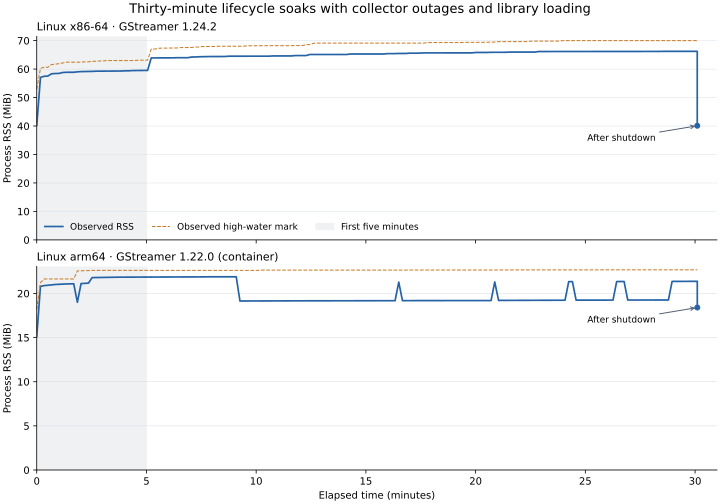

# Profiling and log overhead on 1080p video

The [2026-10-25 matched signal matrix](INSTRUMENT_VIDEO_RESULTS.md#current-full-metrics-signal-matrix--2026-10-25)
contains the current element-attributed profiling results. The earlier
comparisons below remain for historical context.

Measured 2026-10-23. This report checks the current `mars-profiles` entry point
and `mars-otel` with profiles and logs enabled, including actual delivery and
correlation. It replaced the older prototype figures at the time; the newer matrix above
now provides the current planning figures.

## Default export settings

For a rough README figure on this workload, use **about 1% added CPU cycles and
41 MiB added peak RSS for profiles-only**, and **about 4% and 44 MiB for
`mars-otel` with profiles and logs**. These are CPU-cycle observations, not a
measured FPS loss or a general CPU-time guarantee. Profiling is 100 Hz and
logging emits one INFO record per frame. The baseline and profiles-only cycle
ranges overlap, so the sub-percent point estimate should not be treated as a
precise limit.

This separate check uses the default **200 ms trace export interval** and
**8,192-record queue**, with six repetitions per mode and the same driver binary.
Medians, compared only against this series' no-tracer baseline:

| Mode | CPU cycles (billions) | Added cycles | Added instructions | Peak RSS (MiB) | Added RSS (MiB) |
| --- | ---: | ---: | ---: | ---: | ---: |
| No tracer | 52.48 | +0.0% | +0.00% | 26.3 | 0.0 |
| `mars-profiles` | 52.84 | +0.7% | +0.42% | 67.4 | 41.1 |
| `mars-otel`: traces + profiles + logs | 54.35 | +3.6% | +0.60% | 70.2 | 43.9 |

| Mode | CPU cycles range (billions) | Process CPU median / range (s) | Median pipeline FPS |
| --- | ---: | ---: | ---: |
| No tracer | 51.95–53.48 | 13.12 / 12.36–17.76 | 91.5 |
| `mars-profiles` | 52.05–54.57 | 13.92 / 12.57–15.90 | 87.0 |
| `mars-otel`: traces + profiles + logs | 53.17–55.02 | 13.15 / 12.86–20.01 | 92.4 |

The default fully enabled mode made a median **92 HTTP requests** per run,
versus **1,167** with the earlier benchmark settings, and used **70.2 MiB** total
peak RSS rather than **77.1 MiB**. These are separate series on a shared host;
the small cycle difference between them is not evidence that faster export is
cheaper. CPU outside the source thread fell from a median 516 ms to 240 ms,
which includes trace/log export and profile processing, not just HTTP work.

All **18 measured runs** and three warm-ups passed validation, delivering
**28,800 spans**, **7,200 logs**, and **16,942 CPU samples** in the measured runs.
All **2,636 correlated samples** matched exported spans. There were no sample
losses, timer overruns, failed stack reads, truncated snapshots, missing logs,
or shutdown errors.

## Matched comparison with the earlier benchmark settings

Seven-run medians. Profiling is 100 Hz; traces are fully sampled; enabled logging
emits one INFO message per frame. This series uses a **10 ms trace export
interval and a 65,536-record queue**, matching the earlier profiling benchmark.
Those differ from the plugin defaults of 200 ms and 8,192 records. Peak memory
and export costs below are specific to this configuration.

| Mode | CPU cycles (billions) | Added cycles | Added instructions | Process CPU (s) | Peak RSS (MiB) |
| --- | ---: | ---: | ---: | ---: | ---: |
| No tracer | 52.47 | +0.0% | +0.00% | 12.74 | 26.2 |
| Native logs, no tracer | 53.03 | +1.1% | +0.01% | 12.81 | 26.5 |
| `mars-profiles` | 53.10 | +1.2% | +0.55% | 12.66 | 67.7 |
| `mars-otel`: traces | 53.55 | +2.1% | +0.15% | 14.80 | 37.9 |
| `mars-otel`: traces + logs | 54.31 | +3.5% | +0.17% | 12.50 | 38.5 |
| `mars-otel`: traces + profiles | 54.47 | +3.8% | +0.61% | 13.05 | 76.5 |
| `mars-otel`: traces + profiles + logs | 54.27 | +3.4% | +0.75% | 12.87 | 77.1 |

Profiles-only added **1.2% cycles** and **41.6 MiB** peak RSS in this series.
`mars-otel` with profiles and logs added **3.4% cycles** and **50.9 MiB** peak RSS.
These are observed medians, not precise overhead bounds. The native-log control
also differs by 1.1% in cycles, and the profiles-only and baseline cycle ranges
overlap. Small differences between tracing configurations do not establish that
adding a signal makes tracing faster.

CPU-time and throughput rankings are inconsistent with hardware work: for
example, traces-only appears much slower than traces plus profiles and logs.
Do not use those timings as a claim that adding profiles improves throughput,
or label the cycle percentages as FPS loss. The full observed ranges are:

| Mode | CPU cycles range (billions) | Process CPU range (s) | Median pipeline FPS |
| --- | ---: | ---: | ---: |
| No tracer | 51.99–53.61 | 12.28–16.46 | 94.2 |
| Native logs, no tracer | 52.35–53.48 | 11.75–15.84 | 93.6 |
| `mars-profiles` | 51.99–53.65 | 12.26–16.61 | 95.5 |
| `mars-otel`: traces | 52.92–53.70 | 12.54–17.06 | 82.8 |
| `mars-otel`: traces + logs | 53.35–54.42 | 12.24–17.91 | 98.0 |
| `mars-otel`: traces + profiles | 53.97–55.42 | 12.23–16.39 | 95.2 |
| `mars-otel`: traces + profiles + logs | 53.80–55.92 | 12.74–16.73 | 96.1 |

The measured no-tracer CPU-time range spans 12.28–16.46 seconds for identical
work, while its cycle range spans 51.99–53.61 billion. Frequency, scheduling,
and shared-host effects prevent a reliable small wall-time or CPU-time
percentage. Hardware counters reduce one source of uncertainty; they do not
remove cache, scheduling, or host variability.

## Output and shutdown checks

All **49 measured runs** and seven warm-ups passed output validation. The measured
runs delivered **134,400 spans**, **16,800 logs**, and **27,969 CPU samples**.
All **5,720 correlated samples** referred to exported spans with matching profile
IDs, and every exported log referred to a delivered span. Profiles-only produced
no OTLP requests and no trace/span sample labels. No-tracer modes produced no
telemetry. Exact per-frame log sequences and duplicate span IDs were checked.

No sample-buffer, processing-queue, or upload-queue drops, registration failures,
timer overruns, stack-read failures, or truncated snapshots were reported in
these runs. Final decoded profile weights exactly matched sampler counters.
All shutdowns completed; there were no observed hangs or missing final samples.
This short test does not establish long-term leak freedom or absence of rare
deadlocks. Trace queues also reported no pending, failed, or capacity-dropped spans.

## Timing variability and the pilot

The timing-only pilot was stopped after 26 completed runs because process CPU
varied too much for a useful small-overhead estimate. Its two measured no-tracer
runs took 16.39 and 18.11 CPU seconds, while other modes ranged from 12.58 to
26.19 seconds. The [pilot CSV](2026-10-23-profiles-video-pilot.csv) and
[metadata](2026-10-23-profiles-video-pilot.json) are retained; they are excluded
from the final table.

The final full series also records inherited hardware `cycles` and
`instructions` using `perf stat`. These cover the whole child process and all
its threads, including initialization and shutdown. Counters must have at least
99% scheduling coverage; unscheduled hybrid-CPU counter instances are ignored.
The hardware totals are useful alongside CPU-time measurements when clock
frequency varies. They are not a guarantee of identical throughput on another
machine. Every timing and hardware measurement in the final table comes from
the same instrumented series.

## Workload and method

Measured 2026-10-23 on an Intel Core i5-1345U, Linux x86-64, stock GStreamer
1.24.2 and Rust 1.89.0. The implementation is from `4377158`; this change adds
the benchmark driver and reports without changing tracer code. Every mode uses
the same release binary built with `-C force-frame-pointers=yes`. The driver
instantiates the same Rust tracer types as the plugin factories, allowing an
explicit `gstoteltracer::shutdown()` and exact checks of final sampler counters.

Each child generates 1,200 frames of 1920×1080 RGBA noise, converts to I420,
and discards the result without clock pacing:

```text
videotestsrc pattern=snow ! RGBA,1920×1080 ! videoconvert ! I420 ! fakesink sync=false
```

The two caps filters make four pushes per frame: 4,800 spans when tracing is
active. There is one streaming thread, no queue, decoding, inference, or GPU
work. The source's noise generation contributes substantial CPU outside active
push spans; profiling also samples that work after the thread registers.

The main series uses seven measured repetitions per mode after one discarded
warm-up per mode. Mode order rotates through all seven positions. The separate
default-settings check uses six measured repetitions and one warm-up for each
of its three modes, rotating through all three positions twice. Children run on
physical P cores 0 and 2; the Python HTTP receiver runs on CPU 4. Frequency is not pinned
(`powersave` governor), and other desktop services remain active. No builds or
test suites ran during the recorded series. Every repetition starts a new
process, so each includes a cold symbol cache and multiple reporting intervals.

The main series matches the older benchmark settings: 100% root sampling, a
65,536-record trace queue, batches of 512, and a 10 ms trace export interval.
The separate default-settings check uses the plugin defaults of 8,192 records
and a 200 ms interval; other settings and the binary are identical. Profiling
runs at 100 Hz. Logging modes emit one INFO message per frame from the sink-pad
probe, inside an active push,
using `GST_DEBUG=0,mars-profile-bench:4`. The ordinary GStreamer stderr handler
remains enabled; its output is captured by the parent. The no-tracer native-log
control emits the same messages. Other modes execute the same disabled log
call. No other categories are enabled. This is a defined moderate log workload,
not a benchmark of unrestricted debug logging.

The local HTTP receiver acknowledges and stores actual requests, then decodes
them after the child exits. Remote storage and Grafana are not part of timing.
Traces and logs use OTLP/HTTP protobuf; profiles use the Pyroscope push protocol.

- **Process CPU** covers all child threads from entering PLAYING through NULL
  and explicit exporter/profiler shutdown, including final symbolization and
  uploads. It excludes initialization and graph construction. `total_cpu_ns`
  in the raw data additionally includes those startup operations.
- **Streaming CPU** covers the source thread from its first buffer probe to EOS,
  excluding generation of the first frame. **Wall time** ends at EOS and excludes
  shutdown; FPS is 1,200 divided by that wall time.
- **Peak RSS** is the child's `/proc/self/status` `VmHWM`. It includes initialization,
  loaded code, sampler storage, symbolization, and allocator retention. It excludes
  the Python receiver. Added memory is the difference between mode medians.
- **Added cycles** is the percentage difference between each mode's median
  whole-process hardware cycles and the no-tracer median. Process CPU-time
  differences are also reported, with their observed ranges. Neither measure
  is FPS loss or percentage points of host CPU utilization.

## Scope

These measurements apply to this CPU-heavy conversion workload, build, and host.
Native libraries were not rebuilt with frame pointers; Rust frame-pointer flags
do not improve native unwinding. Different installed debug symbols and libraries
can change profile quality, symbolization cost, and memory. Higher sample rates,
more streaming threads, higher log volume, and network failures need separate
measurements. The current profiles-only implementation should not be assigned
the historical prototype's 6–8% figure without this matched comparison.

The earlier profiling tables compared tracing alone with an older correlated
profiler and later compared two profiler implementations. Their baselines,
driver, shutdown handling, and execution dates differ; they remain historical
results rather than interchangeable measurements.

## Reproduce

Run from the repository root, choosing CPU affinities available on your host.
The hardware-counter runs require Linux `perf` and permission to read counters:

```sh
RUSTFLAGS="-C force-frame-pointers=yes" cargo build --release \
  -p gst-otel-tracer --features profiles --example profile_video \
  --target-dir target/profile-video-build

taskset -c 4 python3 tracer/otel/bench/profile_video.py \
  --perf --cpus 0,2 --frames 1200 --repeats 7 \
  --output reports/otel/2026-10-23-profiles-video.csv
```

The default-settings check uses:

```sh
taskset -c 4 python3 tracer/otel/bench/profile_video.py \
  --perf --cpus 0,2 --frames 1200 --repeats 6 \
  --modes none profiles otel-profiles-logs \
  --export-interval-ms 200 --queue-capacity 8192 \
  --output reports/otel/2026-10-23-profiles-video-defaults.csv
```

The [runner](../../tracer/otel/bench/profile_video.py) and
[driver](../../tracer/otel/examples/profile_video.rs) fail on missing spans,
logs, or profile sample weights, mismatched correlation, drop counters, and
shutdown errors. The [raw CSV](2026-10-23-profiles-video.csv) retains warm-ups
(`repeat=-1`) and every measured run. [Build and environment metadata](2026-10-23-profiles-video.json)
includes the binary, driver, decoder and lockfile hashes. Per-run diagnostic
logs are written to `target/profile-video-runs/`.

The defaults check has its own [raw CSV](2026-10-23-profiles-video-defaults.csv)
and [metadata](2026-10-23-profiles-video-defaults.json). The runner gained explicit
export-interval and queue-capacity options between series; the driver binary
remained identical. The recorded source hashes reflect each measurement.

## Symbolization cost and cache retention — 2026-10-25

The default `full` symbolizer now preserves entries belonging to unchanged library mappings and evicts stale entries selectively under pressure. The optional `MARS_PROFILE_SYMBOLIZATION=functions` mode resolves ELF function names without DWARF, source locations or inline frames. Element attribution and trace correlation remain available in both modes. Resolver code and its loader-lock tests are isolated in [profilesymbols.rs](../../tracer/otel/src/profilesymbols.rs).

This focused x86-64 measurement uses a 178.3 MiB optimized test executable with debug information, six instruction addresses across the executable and libc, and five fresh processes per mode in alternating order. “Cold” means an empty resolver cache; the operating system page cache was not flushed. The warm pass repeats the same addresses. The final pass explicitly clears the cache to measure the cost of the former whole-cache invalidation behavior; it is not a replay of a production workload or a comparison against an older binary.

| Mode / phase | Median process CPU | CPU range | Median process peak RSS | Median RSS after resolution | Retained frame/string bytes |
| --- | ---: | ---: | ---: | ---: | ---: |
| `full` / cold | 80.477 ms | 79.579–85.758 ms | 119.42 MiB | 47.95 MiB | 4,041 |
| `full` / warm | 0.085 ms | 0.084–0.087 ms | 119.42 MiB | 47.95 MiB | 4,041 |
| `full` / cache cleared | 70.748 ms | 69.762–74.680 ms | 122.04 MiB | 53.25 MiB | 4,041 |
| `functions` / cold | 13.409 ms | 13.146–13.824 ms | 13.75 MiB | 10.61 MiB | 971 |
| `functions` / warm | 0.078 ms | 0.076–0.083 ms | 13.75 MiB | 10.61 MiB | 971 |
| `functions` / cache cleared | 12.695 ms | 12.479–13.438 ms | 14.10 MiB | 11.35 MiB | 971 |

The function-only cold pass used about **83% less resolver CPU** and reduced the observed process peak from about **119 MiB to 14 MiB** in this microbenchmark. This is a resolver measurement, **not an 83% pipeline speedup or a general profiler RSS limit**. Warm cache reuse took about 0.08 ms in either mode. Peak RSS is cumulative within each process; later phases inherit earlier peaks. Post-resolution RSS includes allocator retention, while the retained-byte column counts only cached frames/strings.

Both modes retain at most 4096 resolved addresses and 4 MiB of frame/string data. Mapping identity includes address range, file offset, device and inode. Tests verify that unrelated mappings preserve cached allocations, changed mappings invalidate their symbols, and capacity pressure keeps the current hot set while evicting stale entries. A separate real-upload test verifies function-only profiles still contain element attribution and omit source locations. The loader-lock regression test and all required repository checks pass. Audit retains the existing allowed Tokio advisory.

For source-level investigations keep `full`. For lower temporary debug-parsing cost, choose `functions`; private functions missing from stripped ELF symbol tables may appear only by library name. Other allocations and large symbol tables can still increase process memory.

Raw [measurements](symbolization/2026-10-25/results.csv), [source/build metadata](symbolization/2026-10-25/metadata.json), and per-run output are retained. Reproduce using the test executable path printed by the build:

```sh
cargo test --profile profiling -p gst-otel-tracer --features profiles --lib --no-run
python3 tracer/otel/bench/symbolization.py --binary PATH_TO_TEST_EXECUTABLE \
  --output reports/otel/symbolization/recheck
```

## Thirty-minute lifecycle soaks — 2026-10-25

Both native runs completed 30 minutes of pipeline and thread recreation, sampled
library loading/unloading, collector outages and recovery, and final concurrent
shutdown. No deadlock occurred. Profile descriptions were reclaimed at every
drained observation, with more than 41,000 retired on each platform and no
exhaustion of the 4096-live-description limit. These finite
synthetic runs establish progress and bounded observed state under this workload;
they do not prove that every production workload is leak- or deadlock-free.

| Native platform | Pipeline lifetimes / new producer threads | Descriptions retired | CPU samples | Uploads containing loader fixture | Final shutdown |
| --- | ---: | ---: | ---: | ---: | ---: |
| x86-64 | 13,939 | 41,817 | 46,945 | 427 | 7 ms |
| arm64 | 13,764 | 41,292 | 43,423 | 358 | 9 ms |

“Final shutdown” includes four concurrent callers followed by 100 repeated calls.
It occurs after pipelines have stopped and a six-second healthy drain window.
No call timed out. Historical export failures remain visible in the returned
per-signal results; an outage run is not expected to return a clean delivery
status. Sampler registrations, live descriptions, pending traces and pending
logs were all zero after shutdown. The pipeline and source weak references had
to expire within one second on every cycle.

### Memory and resource lifetime

All figures are whole-process MiB, including GStreamer, code, caches, sampler
storage and allocator retention. There is no uninstrumented memory control.

| Platform | RSS median, minutes 5–10 | RSS median, minutes 25–30 | RSS range, minutes 25–30 | Observed peak | RSS after shutdown |
| --- | ---: | ---: | ---: | ---: | ---: |
| x86-64 | 64.35 | 66.18 | 66.17–66.24 | 70.00 | 40.10 |
| arm64 | 21.87 | 19.26 | 19.24–21.38 | 22.68 | 18.41 |



The x86-64 run retained some additional memory while warming: its final five
minutes varied by about 0.07 MiB. Zero live descriptions at each drained snapshot
and successful weak-reference checks rule out retained pipeline objects and an
ever-growing description registry in this test. They do not identify every
remaining allocation. The arm64 and x86-64 library/debug environments differ;
their RSS levels are not an architecture efficiency comparison. Sampling rings
are deliberately retained for process lifetime to protect against late signals.

The x86-64 process used 13–15 threads and 13–21 file descriptors at running snapshots, then 3 threads and 4 descriptors after shutdown.

The arm64 process used 12–13 threads and 13–21 file descriptors at running snapshots, then 2 threads and 4 descriptors after shutdown.

Some process/library threads remain until exit; zero active sampler threads does
not mean that every process thread has terminated. Resource counts are sampled
after drains, not continuously observed high-water marks. RSS comes from
`smaps_rollup`; the recorded peak takes the larger of `VmHWM` and current RSS.

### Outage accounting

The receiver deliberately returned HTTP 503 for 20 seconds every two minutes.
Another 12-second phase delayed OTLP responses by 350 ms, exceeding the configured
100 ms request timeout. Profiles were not delayed in that phase. The final five
seconds and settling window used a healthy receiver.

| Platform | Accepted / failed spans | Accepted / failed logs | Accepted / failed metric batches | Profile CPU seconds in HTTP 200 / 503 requests |
| --- | ---: | ---: | ---: | ---: |
| x86-64 | 131,928 / 35,340 | 43,976 / 11,780 | 11,136 / 2,992 | 385.20 / 84.25 |
| arm64 | 130,128 / 35,040 | 43,380 / 11,676 | 10,987 / 2,966 | 356.79 / 77.44 |

Every completed span and emitted log was accounted for as accepted or failed;
there were no trace/log queue overflows. Acceptance resumed after outages.
There were no profile ring, processing or upload-queue drops, failed stack reads,
registration failures, or attribution capacity rejections. Trace hook mismatches,
depth drops and propagation misses were also zero. x86-64 recorded no timer
overruns or truncated stacks. Arm64 recorded **three timer overruns and 123
truncated stacks** (about 0.28% of samples). Truncation retains the interrupted
instruction and available frames; it does not discard the original sample.
These diagnostics are reported separately from queue losses.

All collected CPU samples reached the profile uploader. This is local handoff,
not proof of backend acceptance: the fake receiver intentionally rejected some
profile requests, and the Pyroscope SDK does not expose individual delivery
acknowledgements. The profile column decodes the actual CPU weights received
under each HTTP status. An HTTP 200 written after a client timeout can appear in
receiver totals while the OTLP exporter correctly reports failure; those raw
request counts must not be substituted for client acknowledgement counts.

### Workload, validation and reproduction

The [driver](../../tracer/otel/examples/lifecycle_soak.rs) creates a new native
producer thread and pipeline for each cycle. Four buffers cross a queue and an
identity handoff that does about 2 ms of CPU work and emits an INFO log. This
creates 12 spans and four logs per cycle. After its first push arms sampling, the
producer loads and unloads a [C shared-library fixture](../../tracer/otel/bench/soak_module.c)
whose constructor and destructor each perform 15 ms of thread CPU work while
holding the loader lock. Actual decoded profiles must contain the fixture's
function. This exercises dynamic-loader contention; it does not repeatedly
rescan the GStreamer plugin registry. Each cycle ends with 80 ms idle time.

All four signals and `MARS_MONITORING=all` are enabled. Profiling uses the default
full symbolizer at 100 Hz, trace/log queues hold 256 records with 64-record
batches, and the metrics interval is one second with one-in-16 detailed sampling.
Every approximately ten seconds the driver drains the signals and records
resource/counter snapshots. The HTTP receiver stores aggregate counters, not
the complete payload stream. A parent watchdog bounds the entire test.

Both binaries are release builds with Rust 1.89.0 and frame pointers. x86-64 uses
GStreamer 1.24.2; native arm64 uses GStreamer 1.22.0 inside a container on an
integrated memory nvidia device. The container has a two-CPU quota. Other work,
including compilation, could run concurrently; these are correctness and memory
soaks, not CPU-overhead or throughput measurements. No production application or
backend was part of this test.

The native arm64 profiles-feature suite passed 102 tests, followed by the explicit
real-timer caller-chain test. A separate QEMU check changed PAC return addresses
with both keys A and B and recovered the original callsites. QEMU was not used
for the native sampler or soak. Fresh GStreamer registries also loaded all three
OTel plugin factories on both platforms. The arm64 container blocked the external
scanner helper's file-descriptor setup with `Operation not permitted`; GStreamer
loaded the factories through its in-process fallback. This check therefore does
not validate external scanner isolation in that container. The release-only
loader-lock regression test now compares against the source detail available in
that build; debug test builds still require file/line resolution.

All required formatting, Clippy, workspace tests and dependency-use checks passed.
The audit exited zero with the existing allowed Tokio `RUSTSEC-2026-0386` warning.
GitHub build/test, native arm64 and audit jobs passed for implementation revision
`36c2ea9`. [Source hashes](lifecycle/2026-10-25/source-hashes.json) matched between
the native environments. The earlier x86 executable predates the test-only
release-symbol assertion adjustment; runtime code and the soak harness match.

Reproduce from the repository root on native Linux x86-64 or arm64 with a C
compiler and the project's GStreamer prerequisites installed:

```sh
RUSTFLAGS='-C force-frame-pointers=yes' cargo build --locked --release \
  -p gst-otel-tracer --features profiles --example lifecycle_soak
python3 tracer/otel/bench/lifecycle_soak.py --seconds 1800 \
  --output target/lifecycle-soak
```

Retained data includes [summary statistics](lifecycle/2026-10-25/summary.json),
[validation results](lifecycle/2026-10-25/validation.json),
settings and binary hashes ([x86-64](lifecycle/2026-10-25/x86_64/metadata.json),
[arm64](lifecycle/2026-10-25/aarch64/metadata.json)), complete snapshots
([x86-64](lifecycle/2026-10-25/x86_64/snapshots.json),
[arm64](lifecycle/2026-10-25/aarch64/snapshots.json)), final receiver/counter results
([x86-64](lifecycle/2026-10-25/x86_64/result.json),
[arm64](lifecycle/2026-10-25/aarch64/result.json)), and compressed stdout/stderr
([x86-64](lifecycle/2026-10-25/x86_64/logs.tar.gz),
[arm64](lifecycle/2026-10-25/aarch64/logs.tar.gz)).
