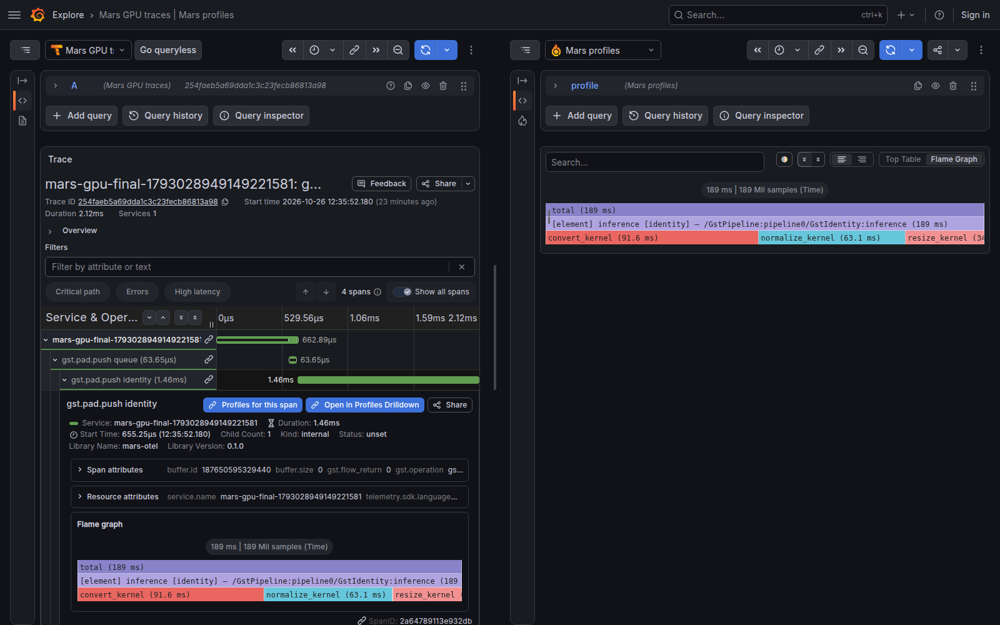
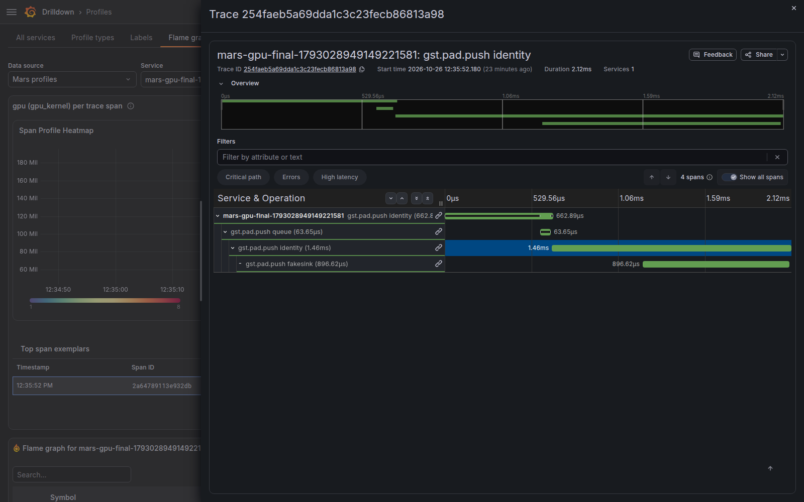

# Experimental GPU element profiles

This branch explores **element → CUDA kernel** profiles correlated with Mars
spans and traces. It is an optional extension, disabled by default. GPU weights
are measured kernel durations; no CPU stacks or device function sampling are
collected by this source.

**Known blocker:** separate reports for the same submission bucket currently
reuse a pprof timestamp. Pyroscope can discard these reports during compaction,
even after acknowledging every upload, so displayed GPU totals can be incomplete
and change after ingestion. Distinct report timestamps and a check after
compaction are required before relying on these totals. See Pyroscope's
[series/timestamp deduplication](https://github.com/grafana/pyroscope/blob/v2.4.0/pkg/block/section_profiles.go#L361-L374).

```text
[element] inference [identity]
  resize_kernel
  normalize_kernel
  convert_kernel
```

These are sibling kernel frames. Repeated launches within the same element,
span, device and submission window are aggregated. Concurrent kernel durations
can overlap: their sum is neither GPU utilization nor elapsed pipeline latency.

## Enable the experiment

Build the Rust plugin with `--features gpu-profiles`. This includes CPU profiling
support but does not require CUDA headers on the build machine. Select sources
with `MARS_PROFILE_SOURCES=cpu`, `gpu`, or `cpu,gpu`; the default is `cpu`.
The `profiles` signal must still be enabled.

The separate native adapter currently requires **CUDA 11.4 headers and the
matching CUPTI runtime**. Other SDK versions require a version-specific record
decoder and validation. The adapter rejects incompatible versions rather than
guessing their record layout. On the CUDA host:

```sh
cargo build --release -p gst-otel-tracer --features gpu-profiles
CUDA_ROOT=/usr/local/cuda-11.4 CUDA_TARGET=aarch64-linux \
  sh tracer/otel/native/build-gpu-adapter.sh target/libmars-cupti.so

export GST_PLUGIN_PATH="$PWD/target/release${GST_PLUGIN_PATH:+:$GST_PLUGIN_PATH}"
export MARS_GPU_ADAPTER="$PWD/target/libmars-cupti.so"
export MARS_PROFILE_SOURCES=gpu
export MARS_PROFILE_URL=http://localhost:4040
export OTEL_SERVICE_NAME=my-video-pipeline
export OTEL_EXPORTER_OTLP_ENDPOINT=http://localhost:4318
export GST_TRACERS='mars-instrument(signals="traces,profiles")'
# Run the application's CUDA-backed pipeline here.
```

Use `CUDA_TARGET=x86_64-linux` for the corresponding SDK installation. GPU-only
profiling does not install the CPU sampling signal or create CPU timers. The
adapter is loaded only when the GPU source is explicitly requested. Missing
libraries, an occupied CUPTI subscription, or initialization errors are reported
through the tracer's initialization diagnostics (`GST_DEBUG=mars-otel:5`).

## Correlation and time semantics

A launch callback snapshots the active element and sampled span. The background
worker joins subsequent CUPTI kernel activities using that launch's correlation
ID. Element descriptions remain alive while the join is pending, including
after the original element or pipeline has been destroyed.

The resulting profile type is
`gpu_kernel:gpu:nanoseconds:gpu:nanoseconds`. Each sample carries `span_id` and
`trace_id`, and eligible spans carry `pyroscope.profile.id`. These IDs remain
sample labels, not profile-series labels.

Profiles describe **GPU work submitted during the selected host time window**.
They use one-second submission buckets and the eventual measured device
duration. Work can finish after its span ends. This preserves the span lookup
without extending CPU spans or forcing GPU synchronization. A profile can appear
after the corresponding trace has already arrived. Allow at least a second of
padding when querying a short span's submission bucket.

Configure Grafana's trace-to-profiles setting with the GPU profile type. The
optional demo overlay adds a separate **Mars GPU traces** data source:

```sh
docker compose -f tracer/otel/bench/correlation/compose.yaml \
  -f tracer/otel/bench/gpu/compose.yaml up -d
```

The regular [correlation guide](CORRELATION.md) explains the marker and service
mapping. The overlay also enables Grafana's experimental `profilesHeatmap`
feature. In Profiles Drilldown, select **Flame graph → Span heatmap**, choose
**Mars GPU traces** as the Tempo data source, then use **Open trace** on a span
exemplar. This reverse path was tested with Grafana 13.1.1, Profiles Drilldown
3.0.0, Pyroscope 2.4.0 and Tempo 2.10.0. It needs Pyroscope's v2 storage and span
exemplar support; the forward link alone does not establish that it works.
See Grafana's [Profiles to Traces documentation](https://grafana.com/docs/grafana/latest/visualizations/simplified-exploration/profiles/choose-a-view/).

The preview UI currently displays the custom GPU type's heatmap values as raw
nanoseconds (for example, `188.79 Mil` means about 188.79 ms); the flame graph
formats the same weights as time. Its span-name column was empty in the tested
version, but the span IDs, durations and trace navigation worked. The capture
script uses the normal one-minute correlation padding: very short windows can
omit the service from Drilldown's catalog even when its span profile is queryable.

## Demo and checks

`native/gpu_workload.c` supplies a standalone CUDA workload compiled through
NVRTC. It needs no model or processor application. The `gpu_correlation` example
runs two elements on different host threads. Both launch the same three kernel
names with different durations. Execution is deliberately delayed beyond the
submitting calls, and the pipeline is destroyed before application-owned device
synchronization. The example asserts exact kernel counts, attribution, delivery,
and zero CPU samples. Running it with `MARS_PROFILE_SOURCES=cpu,gpu` adds CPU work
inside each element and checks that both sources deliver and release their
shared descriptions.

Build the workload on the CUDA host, with `CUDA_ROOT` and `CUDA_TARGET` set as
above:

```sh
cc -std=c11 -O2 -Wall -Wextra -Werror -shared -fPIC \
  -I"$CUDA_ROOT/targets/$CUDA_TARGET/include" \
  tracer/otel/native/gpu_workload.c \
  -L"$CUDA_ROOT/targets/$CUDA_TARGET/lib/stubs" \
  -L"$CUDA_ROOT/targets/$CUDA_TARGET/lib" \
  -lcuda -lnvrtc -o target/libmars-gpu-workload.so
cargo build --release -p gst-otel-tracer --features gpu-profiles \
  --example gpu_correlation
MARS_GPU_WORKLOAD="$PWD/target/libmars-gpu-workload.so" \
  MARS_SIGNALS=traces,profiles MARS_PROFILE_SOURCES=gpu \
  target/release/examples/gpu_correlation
```

The runtime library search path must include the CUDA libraries and the real
driver; do not add the SDK's `lib/stubs` directory to the runtime search path.

`bench/gpu/check.py` checks every demo span through Grafana's actual backend
proxies. It checks isolated element attribution, the two-frame shape, agreement
between aggregate/span/trace totals, and empty results for an unknown span and
the CPU profile type. It takes the example's stdout plus a JSON file containing
`service_name`, `started_ms`, and `ended_ms`:

```sh
python3 tracer/otel/bench/gpu/check.py --log gpu.log --meta run.json \
  --output gpu-check.json
python3 tracer/otel/bench/gpu/browser.py --result gpu-check.json \
  --output gpu-screenshots
```

`cargo test -p gst-otel-tracer --features gpu-profiles --test gpu_profiles`
uses a fake native adapter on machines without CUDA. It verifies delayed record
ownership, real pprof uploads, server rejection, a bounded caller deadline, and
CPU/GPU coexistence and final description retirement.
It is not evidence that CUPTI works on a device.

## Review captures

The synthetic two-element CUDA pipeline was also run on an integrated memory
nvidia device. All 48 kernel activities were attributed to the correct element
and span and acknowledged by Pyroscope, with no recorded losses. All 16
submitting span profiles passed backend checks, including agreement between
span, trace and aggregate totals. GPU-only mode collected zero CPU samples;
combined mode also delivered 61 CPU samples. Both runs reclaimed all five
element descriptions and left no pending uploads.

These are functional checks, not an overhead benchmark or a production soak.
The named demo kernels intentionally burn device time; they do not perform the
image operations suggested by their names. One 1.46 ms submitting span owned
188.79 ms of GPU kernel work, illustrating asynchronous attribution.

Trace to GPU profile:



The [full-width profile](../../docs/media/gpu-profiles/element-gpu-kernels.png)
shows the element and three sibling kernels without CPU frames.

GPU span exemplar back to its trace:



## Bounds and current limits

- Ordinary driver kernel launches and cooperative launches are collected.
  CUDA Graph replay and device-launched work have not been validated.
- Context on an application's separate worker thread needs explicit propagation;
  absent context is shown as unattributed. GStreamer task ownership remains
  distinct from an active element call, as with CPU profiles.
- CUDA kernels are covered. Dedicated decode/encode engines, copies, utilization
  counters and device function sampling are outside this experiment.
- The event queue, pending launch table and per-report aggregation each cap at
  8,192 entries. A completed kernel releases its launch association immediately;
  launches without a completion expire after 30 seconds. Kernels arriving after
  expiry remain unattributed; they are never assigned the current span.
- The adapter has eight 256 KiB host activity buffers. CUPTI timestamp buffers
  are configured to 1 MiB with a pool limit of four per CUDA context; CUPTI may
  round allocations and also has its own internal memory. The adapter and its
  host buffers remain resident until process exit because CUPTI retains callback
  addresses. Kernel names currently have a 255-byte display limit.
- The existing uploader limits apply independently to GPU profiles: ten queued
  profiles plus one request in flight, bounded payloads and an HTTP timeout.
  Capture uses nonblocking enqueue; report encoding and HTTP run in background.
- Stop streaming and complete application GPU work before an exact final drain.
  The profiler never calls device synchronization. A caller timeout does not
  cancel a CUPTI operation already running in the worker.

`gpu_profile_stats()` exposes capture, attribution, drops, pending contexts and
acknowledged/failed kernel delivery. With instrumentation monitoring enabled,
`mars_instrument_gpu_*` metrics expose those outcomes without kernel/span labels
on metric series. The existing `none`, `core`, and `all` monitoring policy applies.

Implementation review starts with [gpuprofiles.rs](src/gpuprofiles.rs),
[gpuprofileencode.rs](src/gpuprofileencode.rs), and
[gpu_cupti.c](native/gpu_cupti.c).
